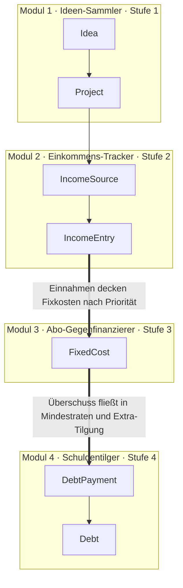

# Personal-Cashflow-Engine – Systemarchitektur

Stand: 2026-11-22 · Diese Datei ist die verbindliche Spezifikation. Der getestete Kern liegt in `docs/reference/core/`.

## Überblick

Die Engine ist eine einzige lokale PWA mit vier nachladbaren Modulen: Jedes Modul schreibt nur in seine eigenen Tabellen, und eine reine Funktion (`runWaterfall`) verteilt daraus das Geld des Monats.



Dünne Pfeile sind Datenbeziehungen per Fremdschlüssel. Dicke Pfeile sind der Geldfluss, den `runWaterfall()` berechnet. Alle Module hängen nur von `src/core` ab.

### Architekturprinzipien

- **Eine Shell, vier Module.** IndexedDB gilt pro Origin. Eine installierte App mit einer Datenbank ist einfacher als vier getrennte Apps.
- **Module kennen nur `core`.** Kein Modul importiert ein anderes. Die Kopplung läuft über Tabellen: Wer fremde Daten braucht, liest sie per `useLiveQuery`.
- **Local-first.** Alle Daten liegen in IndexedDB auf dem Gerät. Die App läuft offline, ohne Server und ohne Login. Das Backup ist ein JSON-Export.
- **Geld in ganzen Cent.** `12,99 €` ist die Zahl `1299`.
- **Berechnen statt speichern.** Die Verteilung des Monats wird live aus den Buchungen berechnet. Erst der Monatsabschluss friert das Ergebnis ein.
- **Die App bewegt kein Geld.** Sie rechnet vor, wohin jeder Euro gehört. Überweisungen macht der Nutzer selbst und bestätigt sie.

### Tech-Stack

| Zweck | Wahl |
| --- | --- |
| Build | Vite |
| Oberfläche | React, TypeScript (strict), Tailwind CSS |
| Routing | React Router, eine lazy Route pro Modul |
| Daten | Dexie (IndexedDB) mit `dexie-react-hooks` |
| Eingabeprüfung | Zod |
| PWA | `vite-plugin-pwa` (Service Worker, Manifest) |
| Tests | Vitest, `fake-indexeddb` für Datenbanktests |

## Projektstruktur und Modul-Vertrag

Ein Modul dockt über genau drei Dinge an: eine Dexie-Version mit seinen Tabellen, einen Eintrag in der Modul-Registry und Lesezugriffe auf fremde Tabellen.

```text
src/
  core/                  # von allen Modulen geteilt
    model.ts             # alle Entities
    money.ts             # Cent-Helfer, Euro-Formatierung
    db.ts                # Dexie-Schema, Version 1 bis 4
    waterfall.ts         # reine Berechnung, ohne React und Dexie
    waterfall.test.ts
    db.test.ts
    modules.ts           # ModuleManifest
  modules/
    ideas/               # Stufe 1
    income/              # Stufe 2
    fixed-costs/         # Stufe 3
    debts/               # Stufe 4
  shell/                 # Rahmen, Navigation, Startseite, Export/Import
    registry.ts          # einzige Stelle, die alle Module kennt
  main.tsx
```

```ts
// core/modules.ts
import type { ComponentType, LazyExoticComponent } from 'react';
import type { ModuleId, YearMonth } from './model';

export interface ModuleManifest {
  id: ModuleId;
  title: string;                                   // Text in der Navigation
  path: string;                                    // z. B. '/ideen'
  Page: LazyExoticComponent<ComponentType>;        // per React.lazy nachgeladen
  DashboardCard?: ComponentType<{ month: YearMonth }>;   // Kachel auf der Startseite
}
```

### Wer schreibt, wer liest

| Modul | schreibt | liest |
| --- | --- | --- |
| Ideen-Sammler | `ideas`, `projects` | `incomeEntries` (für Soll gegen Ist) |
| Einkommens-Tracker | `incomeSources`, `incomeEntries` | `projects` |
| Abo-Gegenfinanzierer | `fixedCosts` | `projects`, Ergebnis von `runWaterfall` |
| Schuldentilger | `debts`, `debtPayments`, `monthCloses` | Ergebnis von `runWaterfall` |
| Shell | `settings` | alles (Startseite, Export) |

Jede Tabelle hat genau einen Schreiber.

## Gemeinsames Datenmodell

Neun Entities tragen die ganze Suite.

| Beziehung | Kardinalität | Schlüssel |
| --- | --- | --- |
| Idea → Project | 1 : 0..1 | `Idea.projectId`, `Project.ideaId` |
| Project → IncomeSource | 1 : n | `IncomeSource.projectId` |
| IncomeSource → IncomeEntry | 1 : n | `IncomeEntry.sourceId` |
| Project → FixedCost | 1 : n, optional | `FixedCost.projectId` |
| Debt → DebtPayment | 1 : n | `DebtPayment.debtId` |
| MonthClose → DebtPayment | 1 : n | `DebtPayment.monthCloseId` |

Micro-Tasks brauchen kein Projekt: Sie sind eine `IncomeSource` mit `kind: 'microtask'` und ohne `projectId`.

```ts
// core/model.ts — das gemeinsame Datenmodell aller vier Module
import type { WaterfallResult } from './waterfall';

export type ID = string;          // crypto.randomUUID()
export type ISODate = string;     // '2026-11-22'
export type YearMonth = string;   // '2026-11' (als String sortierbar)
export type Cents = number;       // immer ganze Cent: 12,99 € = 1299

export interface BaseEntity {
  id: ID;
  createdAt: ISODate;
  updatedAt: ISODate;
  archivedAt?: ISODate;           // archivieren statt löschen
}

// ── Modul 1: Ideen-Sammler ────────────────────────────────────────────
export type IdeaStatus = 'inbox' | 'validating' | 'validated' | 'rejected' | 'promoted';
export type ValidationCriterion =
  | 'demand'            // Gibt es zahlende Nachfrage?
  | 'effort'            // Aufwand bis zum ersten Angebot
  | 'timeToFirstEuro'   // Wie schnell kommt der erste Euro?
  | 'startupCost'       // Was kostet der Start?
  | 'energy';           // Zieht es mich an oder kostet es Kraft?

export interface ValidationCheck {
  criterion: ValidationCriterion;
  rating: 1 | 2 | 3 | 4 | 5;
  note?: string;
}

export interface IdeaEstimate {
  setupHours: number;
  monthlyRevenue: Cents;
  monthlyCost: Cents;
}

export interface Idea extends BaseEntity {
  title: string;
  description: string;
  tags: string[];
  status: IdeaStatus;
  checks: ValidationCheck[];
  score?: number;                 // 0–100, aus checks berechnet
  estimate?: IdeaEstimate;
  projectId?: ID;                 // gesetzt, sobald status = 'promoted'
}

export type ProjectStatus = 'active' | 'paused' | 'done' | 'dropped';

export interface Project extends BaseEntity {
  name: string;
  status: ProjectStatus;
  ideaId?: ID;                    // Herkunft; Projekte dürfen auch ohne Idee entstehen
  monthlyTarget?: Cents;          // aus Idea.estimate übernommen
  nextStep?: string;
}

// ── Modul 2: Einkommensquellen-Tracker ────────────────────────────────
export type IncomeSourceKind = 'project' | 'microtask' | 'recurring' | 'other';

export interface IncomeSource extends BaseEntity {
  name: string;
  kind: IncomeSourceKind;
  projectId?: ID;                 // Pflicht bei kind = 'project'
  platform?: string;
  inWaterfall: boolean;           // false = wird erfasst, aber nicht verteilt
}

export interface IncomeEntry extends BaseEntity {
  sourceId: ID;
  amount: Cents;                  // netto, so wie es am Konto ankommt
  receivedOn: ISODate;
  month: YearMonth;               // aus receivedOn abgeleitet, indexiert
  hoursSpent?: number;            // für den Stundenlohn je Quelle
  note?: string;
}

// ── Modul 3: Abo-Gegenfinanzierer ─────────────────────────────────────
export type BillingCycle = 'monthly' | 'quarterly' | 'yearly';

export interface FixedCost extends BaseEntity {
  name: string;
  amount: Cents;                  // pro Abrechnungszyklus
  cycle: BillingCycle;
  dueDay: number;                 // 1–28
  priority: number;               // 1 wird zuerst gedeckt
  category: 'essential' | 'tool' | 'comfort';
  activeFrom: YearMonth;
  activeUntil?: YearMonth;        // gekündigt zum
  projectId?: ID;                 // Tool-Abo eines Projekts → Projektmarge
}

// ── Modul 4: Schuldentilger ───────────────────────────────────────────
export type DebtStrategy = 'snowball' | 'avalanche';

export interface Debt extends BaseEntity {
  name: string;
  creditor?: string;
  originalAmount: Cents;
  balance: Cents;                 // ändert sich nur über DebtPayment oder Zinsbuchung
  aprBps: number;                 // Jahreszins in Basispunkten: 1250 = 12,5 %
  minPayment: Cents;              // monatliche Mindestrate
  status: 'open' | 'paid';
}

export interface DebtPayment extends BaseEntity {
  debtId: ID;
  amount: Cents;
  paidOn: ISODate;
  month: YearMonth;
  kind: 'minimum' | 'extra';
  monthCloseId?: ID;              // aus welchem Monatsabschluss
}

// ── Core: Einstellungen und Monatsabschluss ───────────────────────────
export type ModuleId = 'ideas' | 'income' | 'fixedCosts' | 'debts';

export interface EngineSettings {
  id: 'settings';                 // genau ein Datensatz
  currency: 'EUR';
  debtStrategy: DebtStrategy;
  buffer: Cents;                  // Rücklage pro Monat vor der Extra-Tilgung, 0 = aus
  enabledModules: ModuleId[];
}

export interface MonthClose extends BaseEntity {
  month: YearMonth;               // eindeutig
  result: WaterfallResult;        // eingefrorenes Ergebnis
}
```

## Wasserfall-Berechnung

Der Überschuss eines Monats ist der Rest des Einnahmen-Topfs nach den Fixkosten. Er fließt vollständig in die Schulden: zuerst in alle Mindestraten, dann komplett in eine Zielschuld.

1. **Topf füllen.** Alle `IncomeEntry` des Monats aus Quellen mit `inWaterfall: true`.
2. **Fixkosten decken.** Nach `priority` aufsteigend, bei Gleichstand das günstigere zuerst. Jahres- und Quartalsabos zählen mit ihrem aufgerundeten Monatsanteil. Reicht der Topf nicht, weist das Ergebnis die Lücke aus und nichts fließt weiter.
3. **Mindestraten zahlen.** Für jede offene Schuld, höchstens ihr Restsaldo.
4. **Puffer halten.** Optional, Standard ist 0.
5. **Extra tilgen.** Der gesamte Rest geht in die Zielschuld. Schneeball wählt den kleinsten Saldo, Lawine den höchsten Zins. Ist sie getilgt, fließt der Rest im selben Monat in die nächste.

### Rechenbeispiel

Drei Abos (20,00 €, 12,99 €, 9,99 €) und drei Schulden: A 300 € zu 0 %, B 1.800 € zu 12,5 %, C 950 € zu 6 %. Mindestraten 25 €, 50 €, 30 €.

| Stufe | Betrag | Rest im Topf |
| --- | --- | --- |
| Einnahmen (2 Buchungen) | + 620,00 € | 620,00 € |
| Fixkosten (3 Abos) | − 42,98 € | 577,02 € |
| Mindestraten | − 105,00 € | 472,02 € |
| Puffer (aus) | 0,00 € | 472,02 € |
| Extra-Tilgung | − 472,02 € | 0,00 € |

Schneeball: 275,00 € tilgen A ganz, 197,02 € gehen in C. Lawine: alle 472,02 € gehen in B. Bei gleichbleibenden Einnahmen sind beide nach 6 Monaten schuldenfrei, Lawine mit 64,86 € Zinsen, Schneeball mit 90,27 €. Diese Werte stehen als Tests in `docs/reference/core/waterfall.test.ts`.

### core/waterfall.ts

```ts
// core/waterfall.ts — reine Funktionen, keine Imports aus React oder Dexie
import type { Cents, DebtStrategy, ID, YearMonth } from './model';

export interface WaterfallInput {
  month: YearMonth;
  incomes: { id: ID; amount: Cents }[];
  fixedCosts: { id: ID; monthlyAmount: Cents; priority: number }[];
  debts: { id: ID; balance: Cents; aprBps: number; minPayment: Cents }[];
  strategy: DebtStrategy;
  buffer: Cents;
}

export interface WaterfallResult {
  month: YearMonth;
  totalIncome: Cents;
  fixedCosts: { id: ID; due: Cents; covered: Cents }[];
  fixedCostsDue: Cents;
  fixedCostsCovered: Cents;
  fixedCostGap: Cents;             // > 0: Einnahmen decken die Fixkosten nicht
  surplus: Cents;                  // Rest nach Fixkosten = Andockpunkt für Modul 4
  debtPayments: { debtId: ID; minimum: Cents; extra: Cents; balanceAfter: Cents }[];
  minimumGap: Cents;               // > 0: Mindestraten nicht voll gedeckt
  bufferHeld: Cents;
  totalToDebt: Cents;
  unallocated: Cents;              // bleibt nur übrig, wenn alle Schulden getilgt sind
}

const sum = (xs: number[]): number => xs.reduce((a, b) => a + b, 0);

export function runWaterfall(input: WaterfallInput): WaterfallResult {
  // Stufe 0: alle Einnahmen des Monats in einen Topf
  const totalIncome = sum(input.incomes.map((i) => i.amount));
  let pool = totalIncome;
  const take = (wanted: Cents): Cents => {
    const got = Math.max(0, Math.min(pool, wanted));
    pool -= got;
    return got;
  };

  // Stufe 1: Fixkosten nach Priorität, bei Gleichstand das günstigere zuerst
  const fixedCosts = [...input.fixedCosts]
    .sort((a, b) => a.priority - b.priority || a.monthlyAmount - b.monthlyAmount || a.id.localeCompare(b.id))
    .map((fc) => ({ id: fc.id, due: fc.monthlyAmount, covered: take(fc.monthlyAmount) }));
  const fixedCostsDue = sum(fixedCosts.map((f) => f.due));
  const fixedCostsCovered = sum(fixedCosts.map((f) => f.covered));
  const surplus = pool;

  // Reihenfolge der Schulden: Schneeball = kleinster Saldo, Lawine = höchster Zins
  type D = WaterfallInput['debts'][number];
  const bySnowball = (a: D, b: D) => a.balance - b.balance || b.aprBps - a.aprBps || a.id.localeCompare(b.id);
  const byAvalanche = (a: D, b: D) => b.aprBps - a.aprBps || a.balance - b.balance || a.id.localeCompare(b.id);
  const ordered = input.debts
    .filter((d) => d.balance > 0)
    .sort(input.strategy === 'snowball' ? bySnowball : byAvalanche);

  // Stufe 2: Mindestraten aller offenen Schulden
  const plan = ordered.map((d) => {
    const due = Math.min(d.minPayment, d.balance);
    const minimum = take(due);
    return { debtId: d.id, due, minimum, extra: 0, balanceAfter: d.balance - minimum };
  });
  const minimumGap = sum(plan.map((p) => p.due - p.minimum));

  // Stufe 3: optionale Rücklage
  const bufferHeld = take(input.buffer);

  // Stufe 4: der gesamte Rest als Extra-Tilgung; ist die Zielschuld getilgt,
  // fließt der Rest im selben Monat in die nächste (Kaskade)
  for (const p of plan) {
    p.extra = take(p.balanceAfter);
    p.balanceAfter -= p.extra;
  }

  return {
    month: input.month,
    totalIncome,
    fixedCosts,
    fixedCostsDue,
    fixedCostsCovered,
    fixedCostGap: fixedCostsDue - fixedCostsCovered,
    surplus,
    debtPayments: plan.map(({ debtId, minimum, extra, balanceAfter }) => ({ debtId, minimum, extra, balanceAfter })),
    minimumGap,
    bufferHeld,
    totalToDebt: sum(plan.map((p) => p.minimum + p.extra)),
    unallocated: pool,
  };
}

// Monatszins auf den Saldo, kaufmännisch auf ganze Cent gerundet
export const monthlyInterest = (balance: Cents, aprBps: number): Cents =>
  Math.round((balance * aprBps) / 120000);

export const nextMonth = (ym: YearMonth): YearMonth => {
  const [y, m] = ym.split('-').map(Number);
  return m === 12 ? `${y + 1}-01` : `${y}-${String(m + 1).padStart(2, '0')}`;
};

// Prognose: denselben Monat wiederholen, bis alle Schulden getilgt sind
export function simulatePayoff(base: WaterfallInput, maxMonths = 600) {
  let debts = base.debts.map((d) => ({ ...d }));
  let month = base.month;
  let interestPaid = 0;
  for (let n = 1; n <= maxMonths; n++) {
    debts = debts.map((d) => {
      const interest = monthlyInterest(d.balance, d.aprBps);
      interestPaid += interest;
      return { ...d, balance: d.balance + interest };
    });
    const r = runWaterfall({ ...base, month, debts });
    debts = debts.map((d) => ({ ...d, balance: r.debtPayments.find((p) => p.debtId === d.id)?.balanceAfter ?? 0 }));
    if (debts.every((d) => d.balance === 0)) return { months: n, debtFreeIn: month, interestPaid };
    if (r.totalToDebt === 0) return null;        // kein Überschuss: keine Prognose möglich
    month = nextMonth(month);
  }
  return null;
}
```

### core/db.ts

`loadWaterfallInput` ist die einzige Stelle, an der Tabellen zu Eingaben werden. Fehlt eine Tabelle, liefert sie eine leere Liste. Der Parameter `upTo` im Konstruktor dient nur den Upgrade-Tests.

```ts
// core/db.ts — eine Dexie-Version pro Ausbaustufe
import Dexie, { type Table } from 'dexie';
import type {
  Cents, Debt, DebtPayment, EngineSettings, FixedCost, Idea, IncomeEntry, IncomeSource, MonthClose, Project, YearMonth,
} from './model';
import type { WaterfallInput } from './waterfall';

export class EngineDB extends Dexie {
  ideas!: Table<Idea, string>;
  projects!: Table<Project, string>;
  settings!: Table<EngineSettings, string>;
  incomeSources!: Table<IncomeSource, string>;
  incomeEntries!: Table<IncomeEntry, string>;
  fixedCosts!: Table<FixedCost, string>;
  debts!: Table<Debt, string>;
  debtPayments!: Table<DebtPayment, string>;
  monthCloses!: Table<MonthClose, string>;

  constructor(name = 'cashflow-engine', upTo = 4) {
    super(name);
    // Stufe 1: Ideen-Sammler
    this.version(1).stores({ ideas: 'id, status, updatedAt', projects: 'id, status, ideaId', settings: 'id' });
    // Stufe 2: Einkommens-Tracker
    if (upTo >= 2) this.version(2).stores({ incomeSources: 'id, kind, projectId', incomeEntries: 'id, sourceId, month' });
    // Stufe 3: Abo-Gegenfinanzierer
    if (upTo >= 3) this.version(3).stores({ fixedCosts: 'id, priority, projectId' });
    // Stufe 4: Schuldentilger
    if (upTo >= 4) this.version(4).stores({ debts: 'id, status', debtPayments: 'id, debtId, month', monthCloses: 'id, &month' });
  }
}

export const monthlyEquivalent = (fc: FixedCost): Cents =>
  fc.cycle === 'monthly' ? fc.amount : Math.ceil(fc.amount / (fc.cycle === 'quarterly' ? 3 : 12));

const isActive = (fc: FixedCost, month: YearMonth): boolean =>
  !fc.archivedAt && fc.activeFrom <= month && (!fc.activeUntil || month <= fc.activeUntil);

const has = (db: EngineDB, table: string): boolean => db.tables.some((t) => t.name === table);

// Der einzige Ort, an dem Tabellen zu Wasserfall-Eingaben werden.
// Fehlt eine Tabelle (Modul noch nicht gebaut), liefert sie eine leere Liste.
export async function loadWaterfallInput(db: EngineDB, month: YearMonth): Promise<WaterfallInput> {
  const settings = await db.settings.get('settings');
  const sources = has(db, 'incomeSources') ? await db.incomeSources.toArray() : [];
  const counted = new Set(sources.filter((s) => s.inWaterfall && !s.archivedAt).map((s) => s.id));
  const entries = has(db, 'incomeEntries') ? await db.incomeEntries.where('month').equals(month).toArray() : [];
  const costs = has(db, 'fixedCosts') ? await db.fixedCosts.toArray() : [];
  const debts = has(db, 'debts') ? await db.debts.where('status').equals('open').toArray() : [];
  return {
    month,
    incomes: entries.filter((e) => counted.has(e.sourceId)).map((e) => ({ id: e.id, amount: e.amount })),
    fixedCosts: costs.filter((fc) => isActive(fc, month)).map((fc) => ({ id: fc.id, monthlyAmount: monthlyEquivalent(fc), priority: fc.priority })),
    debts: debts.map((d) => ({ id: d.id, balance: d.balance, aprBps: d.aprBps, minPayment: d.minPayment })),
    strategy: settings?.debtStrategy ?? 'avalanche',
    buffer: settings?.buffer ?? 0,
  };
}
```

## Umfang je Modul

### Shell (Koordinator)

- Navigation, Startseite mit einer Kachel pro Modul und der Monatsauswahl.
- Einstellungen: Strategie (Schneeball oder Lawine), Puffer.
- JSON-Export und -Import aller Tabellen, PWA-Installation, Offline-Betrieb.
- Fordert `navigator.storage.persist()` an und erinnert monatlich an den Export.

### Modul 1 · Ideen-Sammler

- **Kann:** Idee in einem Feld erfassen, mit fünf Kriterien bewerten, Score berechnen, validierte Idee per Knopf zum `Project` machen. Zeigt je Projekt die echten Einnahmen gegen `monthlyTarget`.
- **Score:** Durchschnitt der Bewertungen auf 0 bis 100 skaliert: `round((avg - 1) / 4 * 100)`. Validiert ab 60 Punkten und fünf bewerteten Kriterien.
- **Fertig, wenn:** das Befördern einer Idee ein Projekt anlegt, `Idea.projectId` setzt und den Status auf `promoted` stellt.

### Modul 2 · Einkommens-Tracker

- **Kann:** Quellen anlegen (Projekt oder Micro-Task), eine Einnahme in drei Feldern buchen (Quelle, Betrag, Datum), Monatsübersicht und Stundenlohn je Quelle zeigen.
- **Fertig, wenn:** die Monatssumme der Summe der Buchungen entspricht und die Startseite die Kachel „Einnahmen diesen Monat“ zeigt. Läuft auch ohne Projekte.

### Modul 3 · Abo-Gegenfinanzierer

- **Kann:** Abos mit Betrag, Zyklus und Priorität führen, pro Monat zeigen, welche Abos gedeckt sind, und für das nächste ungedeckte den fehlenden Betrag nennen.
- **Fertig, wenn:** das Rechenbeispiel 577,02 € Überschuss zeigt und ein Monat mit zu wenig Einnahmen die Lücke anzeigt.

### Modul 4 · Schuldentilger

- **Kann:** Schulden mit Saldo, Zins und Mindestrate führen, beide Strategien per `simulatePayoff` vergleichen. Der Monatsabschluss friert das Ergebnis als `MonthClose` ein und schlägt Zahlungen vor, die der Nutzer nach der Überweisung bestätigt. Eine bestätigte Zahlung legt ein `DebtPayment` an und senkt `Debt.balance`; bei Saldo 0 wird `status` zu `paid`.
- **Zinsen:** Der Monatsabschluss bucht keine Zinsen. Der Nutzer korrigiert den Saldo von Hand nach dem Auszug des Gläubigers; nur die Prognose rechnet Zinsen ein.
- **Fertig, wenn:** ein Monat nur einmal abgeschlossen werden kann (Index `&month`) und jeder Saldo dem Ursprungsbetrag plus Zinsen minus Zahlungen entspricht.

## Offene Entscheidungen

Der Bau folgt der Voreinstellung. Änderungen nur nach Rückfrage.

| Entscheidung | Voreinstellung | Alternative |
| --- | --- | --- |
| Welche Einnahmen zählen? | Nur Quellen mit `inWaterfall: true` | Auch das Grundeinkommen als Quelle `recurring` |
| Mindestraten vor Komfort-Abos? | Erst alle Fixkosten, dann Schulden | `essential`, dann Mindestraten, dann `tool` und `comfort` |
| Jahresabos | Monatsanteil jeden Monat | Voller Betrag im Fälligkeitsmonat |
| Strategie | Lawine | Schneeball |
| Reihenfolge von Hand | Nicht vorgesehen | Feld `pinned` |
| Backup | JSON-Export von Hand | Später Sync |
| Bankanbindung | Keine | CSV-Import |
